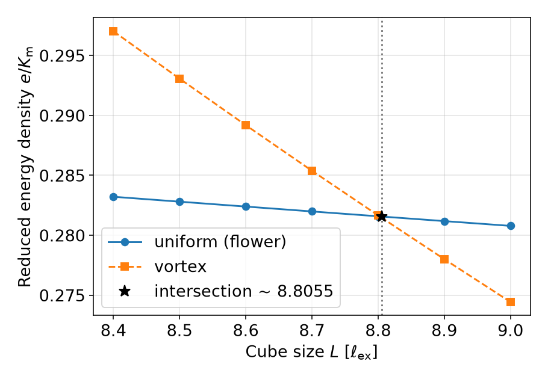

# standard_problem_3

## 1) Purpose of the Example

This problem tests the implementation of the magnetostatic, exchange, and anisotropy energy.

The [µMAG Standard Problem #3](https://www.ctcms.nist.gov/~rdm/spec3.html) focuses on determining the single-domain limit of a cubic ferromagnetic particle. This involves finding the critical size \(L\) at which two competing magnetization configurations—the flower state and the vortex state—have equal total energy. The cube's edge length is expressed in units of the exchange length \(l_{\text{ex}} = \sqrt{A/K_m}\), where \(A\) is the exchange stiffness and \(K_m\) is the magnetostatic energy density (\(K_m = \frac{1}{2}\mu_0 M_s^2\) in SI units). The material is assumed to have a small uniaxial anisotropy (\(K_u = 0.1 K_m\)) with its easy axis aligned along a principal axis of the cube.

## 2) Physics Background

The problem is physically motivated by the competition between exchange, magnetostatic, and anisotropy energies, which govern the stability of magnetic states in small particles. The transition between flower and vortex states typically occurs near \(L \approx 8\,l_{\text{ex}}\), marking the threshold between single-domain and multi-domain behavior in nanoscale magnets.

### Material Parameters

We assume a magnetic polarization \(J_s = \mu_0 M_s = 1\) T and an exchange constant of \(A = 10\) pJ/m. This gives \(l_{\text{ex}} = 5.0132565\,\text{nm}\), \(K_m = 3.97887 \times 10^{5}\,\text{J/m}^3\), and \(K_u = 3.97887 \times 10^{4}\,\text{J/m}^3\). The uniaxial anisotropy axis is along the z-axis of the Cartesian coordinate system.

These values are specified in the material parameters file `cube.krn`:

```text
# theta (rad)   phi (rad)   K1(J/m3)   not used   Js (T)   A (J/m)
0.0             0.0         3.97887e4  0.0        1.0      1.0e-11
```

## 3) How to Run the Example in Tommos

### Fixed Mesh

We use a fixed mesh (`cube.npz`) for all sizes to be computed. During the sweep runs, the physical sample size is varied by scaling the mesh units (`size = (L / 8.6) * 1e-9` in `cube.p2`).

If you ever want to regenerate the base mesh (already included in `examples/standard_problem_3/cube.npz`):

```bash
cd examples/standard_problem_3
pixi run tommos mesh --geom box --extent 43.1140063,43.1140063,43.1140063 --h 2.155700316 --backend grid --out-name cube
```

This creates a cube with an edge length of \(8.6\,l_{\text{ex}}\) and 20 elements along each edge (mesh size smaller than \(l_{\text{ex}}/2\)). The resulting files are:
- `cube.npz` (mesh)
- `cube.vtu` (for visualization)

The material and configuration files are:
- `cube.krn` — intrinsic material properties
- `cube.p2` — simulation setup (`hstart = 0.0`, `hfinal = 0.0`)

### Run a Single Relaxation (Flower or Vortex State)

From `examples/standard_problem_3/`:

```bash
# Relax from the uniform (flower) state:
pixi run tommos loop cube --mesh cube.npz --add-shell --auto-layers --K 2.0 --KL 10.0 --ini uniform --out-dir hyst_uniform

# Relax from the vortex state:
pixi run tommos loop cube --mesh cube.npz --add-shell --auto-layers --K 2.0 --KL 10.0 --ini vortex --out-dir hyst_vortex
```

### Run the Full Size Sweep (`sp3_sweep.py`)

From the `tommos` repository root:

```bash
pixi run python examples/standard_problem_3/sp3_sweep.py
```

---

## 4) How to Analyze and Interpret Results

With the default parameters (`L = 8.4, 8.5, 8.6`), `sp3_sweep.py` computes the reduced energy densities of the flower state (`e_uniform`) and the vortex state (`e_vortex`), prints the comparison table and single-domain limit intersection \(L^*\), and saves the energy crossing plot (`examples/standard_problem_3/runs/sp3_energies.png`):



**Notes:**
The single-domain limit is within the range of results reported on the [µMAG Standard Problem #3 Results](https://www.ctcms.nist.gov/~rdm/results3.html) page. Reducing the mesh size or expanding the air box shifts the single-domain limit to slightly lower values.

---

## 5) User Manual for `sp3_sweep.py`

### Purpose

`sp3_sweep.py` automates µMAG Standard Problem #3 runs across cube edge lengths \(L\) (in units of \(l_{\text{ex}}\)), comparing **uniform (flower)** and **vortex** initial states. It runs two zero-field relaxations per size \(L\), extracts the reduced energies \(e/K_m\) from `cube.mh`, estimates the least-squares linear intersection \((L^*, e^*)\), and plots \(e_{\text{uniform}}/K_m\) and \(e_{\text{vortex}}/K_m\) vs. \(L\).

### Parameters

| Flag | Description | Default |
| :--- | :--- | :--- |
| `--Lstart` | Start size in units of \(l_{\text{ex}}\). | `8.4` |
| `--Lstop` | Stop size in units of \(l_{\text{ex}}\). | `8.6` |
| `--step` | Step size in units of \(l_{\text{ex}}\). | `0.1` |
| `--write-vtu` | Allow `tommos loop` to write VTU snapshots for ParaView. | Off |
| `--loop-arg` | Additional arguments forwarded to `tommos loop` (repeatable). | None |
| `--workdir` | Output directory for per-size runs and plot. | `examples/standard_problem_3/runs` |
| `--png` | Output filename for the energy plot inside `--workdir`. | `sp3_energies.png` |

### Example Commands

#### Sweep `L = 8.4, 8.5, 8.6` with VTU output
```bash
pixi run python examples/standard_problem_3/sp3_sweep.py --write-vtu
```

#### Sweep with custom range and plot filename
```bash
pixi run python examples/standard_problem_3/sp3_sweep.py --Lstart 8.0 --Lstop 9.0 --step 0.5 --png myplot.png
```

#### Forward extra options to `tommos loop`
```bash
pixi run python examples/standard_problem_3/sp3_sweep.py --loop-arg=--KL --loop-arg=12
```
